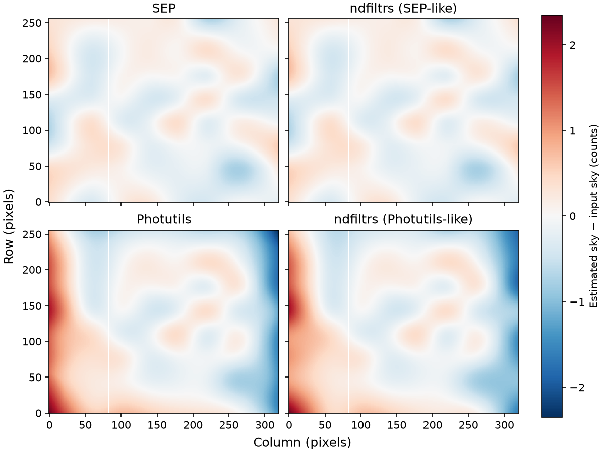

# Estimate sky background

Use [`mesh_background`](https://ysbach.github.io/ndfiltrs/api/mesh_background.html#ndfiltrs.mesh_background)
to subtract a spatially varying sky while preserving stars. Compare its background and
RMS maps with [`sep.Background`](https://sep.readthedocs.io/en/stable/api/sep.Background.html),
[`photutils.background.Background2D`](https://photutils.readthedocs.io/en/stable/api/photutils.background.Background2D.html),
and the known input sky and noise.
The two ndfiltrs fits show how to follow each reference package's mesh rules.

Run the Python blocks in order in one session. From a repository checkout
with ndfiltrs built in its local environment, start that session with

```bash
uv run --no-sync --with sep==1.4.1 --with photutils==3.1.1 --with matplotlib python
```

## 1. Make a star field with a known sky

The sky is a tilted plane in detector counts. Add Gaussian noise with a
standard deviation of 4 counts and 24 stars with Gaussian profiles. Give one
bad column a high finite value so that all three packages can exclude it with
the same Boolean mask. Leave the stars unmasked.

```python
import ndfiltrs as nf
import numpy as np
import sep
from photutils.background import Background2D

rng = np.random.default_rng(42)
y, x = np.indices((256, 320))
sky = 100 + 0.04 * x + 0.02 * y
noise_sigma = 4.0
image = sky + rng.normal(0, noise_sigma, sky.shape)
for cy, cx in rng.uniform((0, 0), image.shape, size=(24, 2)):
    image += 120 * np.exp(-((x - cx) ** 2 + (y - cy) ** 2) / (2 * 1.6**2))

bad = np.zeros(image.shape, dtype=bool)
bad[:, 83] = True
image[bad] = 10000
```

## 2. Fit the background and RMS maps

Each box is 32 rows by 40 columns, much wider than a star. This gives an
8 × 8 grid of complete boxes. Each method applies a 3 × 3 median filter
to that grid. SEP takes separate height and width arguments. Photutils and
ndfiltrs take the box dimensions in NumPy axis order, `(height, width)`.

```python
box = (32, 40)
sep_fit = sep.Background(image, mask=bad, bh=box[0], bw=box[1], fh=3, fw=3)
phot_fit = Background2D(image, box, mask=bad, filter_size=3, exclude_percentile=10)

nf_sep = nf.mesh_background(image, box, mask=bad, interpolation="sextractor")
nf_phot = nf.mesh_background(
    image,
    box,
    mask=bad,
    estimator="sigma_clip",
    sigma=3,
    maxiters=10,
    min_valid_fraction=0.9,
    valid_count="retained",
    valid_base="box",
    fill="idw",
    filter_edge="truncate",
)

maps = {
    "SEP": (sep_fit.back(), sep_fit.rms()),
    "ndfiltrs (SEP-like)": (nf_sep.background, nf_sep.rms),
    "Photutils": (phot_fit.background, phot_fit.background_rms),
    "ndfiltrs (Photutils-like)": (nf_phot.background, nf_phot.rms),
}
```

The SEP-like call selects SEP's 2-D interpolation. Its mesh estimator uses
exact samples, while SEP bins samples into a histogram. The Photutils-like
call requires 90% of each full box to survive masking and clipping. It uses
the default SExtractor mode and population standard deviation of the survivors.
All 64 boxes pass in this example. Inspect the
[`MeshBackground`](https://ysbach.github.io/ndfiltrs/api/MeshBackground.html#attributes)
result for the mesh values and validity flags.

## 3. Subtract the sky and keep the mask

Use the full-resolution maps for subtraction and noise normalization. For
example, the SEP-like ndfiltrs fit gives a residual in counts and a residual
in units of the local background RMS. Stars remain in both images. The RMS
describes the scatter of background pixels. Source shot noise would need a
separate term for photometric uncertainties.

```python
background, rms = maps["ndfiltrs (SEP-like)"]
residual = np.where(bad, np.nan, image - background)
normalized = np.divide(
    residual, rms, out=np.full_like(image, np.nan), where=(~bad) & (rms > 0)
)
```

## 4. Compare each map with the truth

Compute the root-mean-square error (RMSE) over the same unmasked pixels,
including star positions. For the sky map the target is the input plane.
For the RMS map the target is the input noise standard deviation. Both
errors are in counts.

```python
good = ~bad


def rmse(error):
    return np.sqrt(np.mean(error[good] ** 2))


errors = {
    name: (rmse(background - sky), rmse(rms - noise_sigma))
    for name, (background, rms) in maps.items()
}
errors
```

| Fit | Sky RMSE (counts) | Noise RMSE (counts) |
| --- | ---: | ---: |
| SEP | 0.250 | 0.062 |
| ndfiltrs (SEP-like) | 0.252 | 0.062 |
| Photutils | 0.562 | 0.053 |
| ndfiltrs (Photutils-like) | 0.539 | 0.055 |

These values describe this noise realization, box size, and source population.
On a science image, choose boxes wide enough to sample sky around the sources
and small enough to follow the sky gradient. Mask extended sources whose light
would otherwise enter the sky estimate.

## 5. Locate the differences



Each panel shows estimated sky minus input sky on the same color scale.
Red marks an overestimate, which removes too much sky during subtraction.
The blank line is the masked column.

- **SEP pair.** The full-resolution sky maps differ by at most 0.079 counts
  on unmasked pixels. Both follow the same interpolation convention.
- **Photutils pair.** The two filtered sky grids agree within
  $4.0 \times 10^{-13}$ counts. The full-resolution sky maps differ by up to
  0.525 counts. Photutils uses reflected boundaries and clips the interpolated
  sky to the mesh range. ndfiltrs extends a natural cubic spline beyond the
  outer mesh centers.

To reproduce the figure, plot the sky error on a symmetric scale.

```python
import matplotlib.pyplot as plt

limit = max(np.abs(background - sky)[good].max() for background, _ in maps.values())
fig, axes = plt.subplots(
    2, 2, figsize=(8, 6), sharex=True, sharey=True, layout="constrained"
)
for ax, (name, (background, _)) in zip(axes.flat, maps.items()):
    difference = np.ma.array(background - sky, mask=bad)
    panel = ax.imshow(
        difference,
        origin="lower",
        interpolation="nearest",
        cmap="RdBu_r",
        vmin=-limit,
        vmax=limit,
    )
    ax.set_title(name)

fig.supxlabel("Column (pixels)")
fig.supylabel("Row (pixels)")
fig.colorbar(panel, ax=axes, label="Estimated sky − input sky (counts)")
plt.show()
```

For timings on larger images, see the [mesh background benchmarks](benchmarks.md#mesh-background).
For partial boxes, masking limits, and interpolation details, see the
[mesh background reference](background.md).
